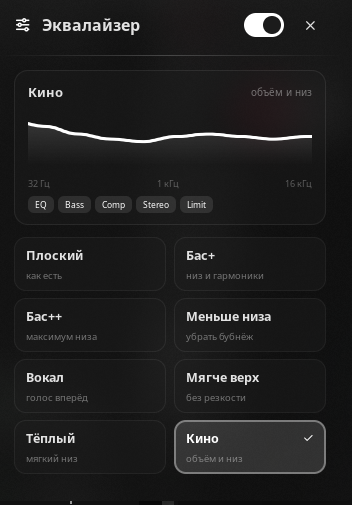
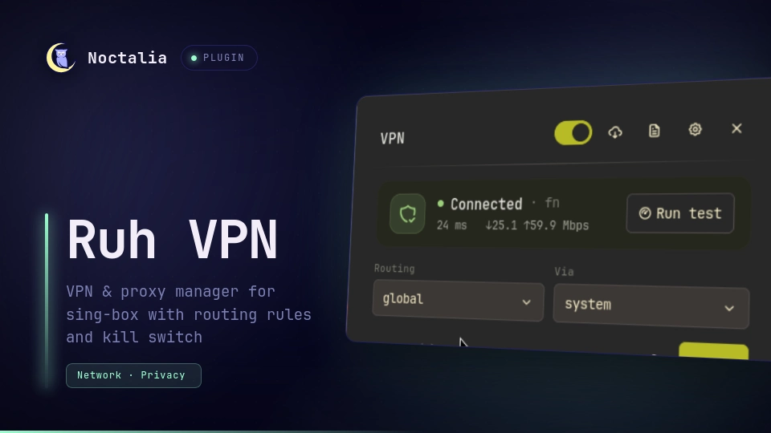
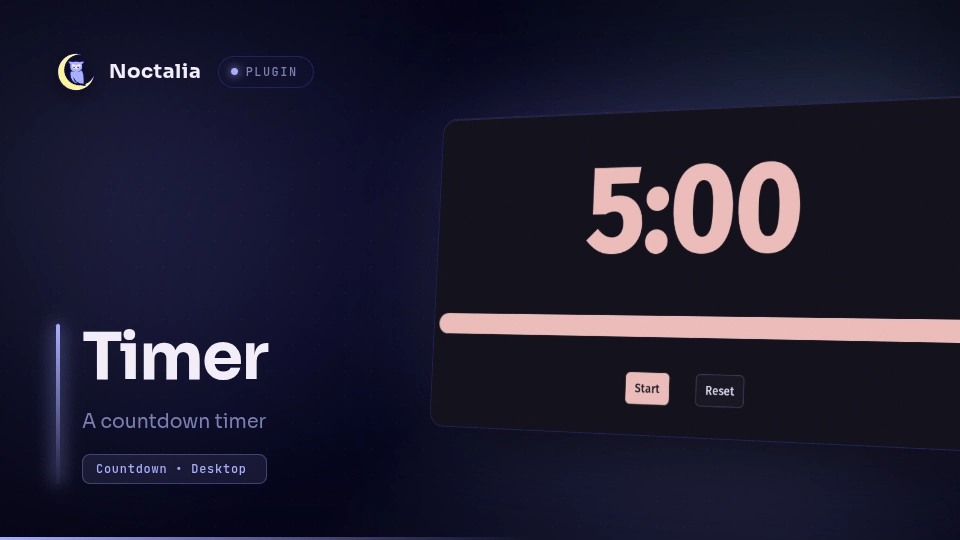

# Плагины Noctalia

Три плагина для [Noctalia](https://github.com/noctalia-dev/noctalia) 5.x:
системный эквалайзер, VPN-менеджер и таймер. Живут в одном репозитории, но
ставятся и работают независимо.


## Что внутри

| Плагин | Что делает | Поверхности | Зависимости |
| --- | --- | --- | --- |
| [equalizer](equalizer/) | эквалайзер с простыми профилями (бас, вокал, кино…) поверх EasyEffects | панель, плитка Control Center, виджет бара | `easyeffects`, `lsp-plugins`, `python3` |
| [ruh-vpn](ruh-vpn/) | VPN/прокси на sing-box: SSH, VLESS, VMess, Shadowsocks, SOCKS5; правила маршрутизации, kill switch, автопереключение серверов | панель, виджет бара, плитка Control Center, headless-сервис | `sing-box`, `python3`, `ssh`, `nft` |
| [timer](timer/) | таймер обратного отсчёта с общим состоянием | панель, виджет бара, десктоп-виджет, сервис | — |

## Скриншоты

| Эквалайзер | VPN | Таймер |
| --- | --- | --- |
|  |  |  |

## Требования

- Noctalia 5.3 или новее (плагины используют `panel`, `widget`, `shortcut`,
  `service` и `noctalia.state`).
- Arch / CachyOS (пакеты):

```bash
sudo pacman -S easyeffects lsp-plugins python3 sing-box
```

- EasyEffects должен быть запущен (движок эквалайзера). Удобно держать его в
  автозапуске без окна — см. ниже.

## Установка

### 1. Клонировать репозиторий

Плагины подключаются как локальный (`path`) источник Noctalia, поэтому папка
должна лежать там, где вы её укажете в настройках:

```bash
git clone https://github.com/Romalakino/noctalia-plugins ~/dev/noctalia-plugins
```

### 2. Прописать источник и включить плагины

`~/.local/state/noctalia/settings.toml`:

```toml
[plugins]
enabled = [ ..., "vlad-dev/equalizer", "vlad-dev/ruh-vpn", "vlad-dev/timer" ]

    [[plugins.source]]
    kind = "path"
    location = "/home/ВЫ/dev/noctalia-plugins"
    name = "vlad-dev"
```

Имя источника (`vlad-dev`) входит в id плагинов — если назовёте иначе,
поменяйте префикс везде ниже.

### 3. Добавить виджеты в бар

```toml
[bar.default]
# порядок в центре — на ваш вкус
center = [ "clock", "vpn_widget", "eq_widget", "bar" ]

[widget.vpn_widget]
type = "vlad-dev/ruh-vpn:vpn_widget"

[widget.eq_widget]
type = "vlad-dev/equalizer:eq_widget"

[widget.bar]              # таймер (вверх ногами: id виджета — "bar")
type = "vlad-dev/timer:bar"
```

### 4. Плитка эквалайзера в Control Center

```toml
[control_center]

    [[control_center.shortcuts]]
    type = "vlad-dev/equalizer:eq"
```

Плитки плагинов не появляются сами — их нужно добавить вручную.

### 5. Перезапустить Noctalia

Правки `plugin.toml` и новых плагинов оболочка подхватывает только при
старте. `panel.luau` перечитывается при следующем открытии панели.

### Автозапуск движка и горячие клавиши

`~/.config/niri/cfg/autostart.kdl`:

```kdl
spawn-at-startup "noctalia"
spawn-at-startup "easyeffects" "--hide-window"
```

`~/.config/niri/cfg/keybinds.kdl`:

```kdl
Mod+Shift+E { spawn-sh "noctalia msg panel-toggle vlad-dev/equalizer:panel"; }
Mod+Shift+V { spawn-sh "noctalia msg panel-toggle vlad-dev/ruh-vpn:vpn_panel"; }
```

## Эквалайзер

`presets.json` — единственный источник правды: из него `eqctl` генерирует
пресеты EasyEffects, а панель рисует кривую АЧХ. Восемь профилей: Плоский,
Бас+, Бас++, Меньше низа, Вокал, Мягче верх, Тёплый, Кино; у каждого свой
набор дополнительных эффектов (bass_enhancer, exciter, deesser, compressor,
stereo_tools, limiter).

```bash
cd ~/dev/noctalia-plugins/equalizer
./eqctl status                 # {"running":true,"bypass":false,"preset":"cinema"}
./eqctl apply bass             # сменить профиль (и снять bypass)
./eqctl bypass on|off|toggle   # обход целиком
./eqctl sync                   # перегенерировать пресеты EasyEffects
```

Панель принимает IPC:

```bash
noctalia msg plugin vlad-dev/equalizer:panel all pick 3      # по номеру
noctalia msg plugin vlad-dev/equalizer:panel all pick vocal  # по id
```

Подробности: [equalizer/README.md](equalizer/README.md).

## VPN

Форк community-плагина `umedbazarov/ruh-vpn` с доработками: подписки Remnawave,
замер пинга, «Fastest», автопереключение при падении узла, русская локализация.
Бэкенд — `sing-box`, управление по RPC на `127.0.0.1:11090` (токен в
`~/.local/state/noctalia/plugins/data/vlad-dev/ruh-vpn/runtime/ruh-vpn-control.token`).

Проверка живости — сквозной запрос через туннель, а не TCP-пинг: сервер может
отвечать на ping и при этом не пропускать трафик. Мёртвые узлы запоминаются в
`bad_nodes.json` и пропускаются при автопереключении.

Подробности: [ruh-vpn/README.fork.md](ruh-vpn/README.fork.md).

## Таймер

Форк `noctalia/timer` с переработанной панелью: пресеты и отдельные поля
часы/минуты/секунды со степперами. Сервис владеет отсчётом, а панель, виджет
бара и десктоп-виджет — тонкие клиенты одного состояния: запуск, пауза или
сброс с любой поверхности сразу видны на остальных.

## Частые проблемы

| Симптом | Причина / решение |
| --- | --- |
| Профиль меняется, звук не меняется | Не установлен `lsp-plugins` — EasyEffects молча пропускает звук насквозь. |
| Плитка в Control Center не показывает текущий профиль | Ограничение Noctalia 5.3: плитки плагинов собираются один раз и подпись не перечитывают. Живое имя профиля показывает виджет бара. |
| VPN «подключён», но сайты не открываются | Сервер не пропускает трафик. `CheckProxy` через RPC или кнопка «Проверить» в панели; автопереключение само уведёт с мёртвого узла. |
| После перезапуска Noctalia VPN отключён | Туннель живёт внутри сервиса плагина. Включите `auto_start` в настройках плагина или подключитесь заново. |
| Виджет бара пропал | После добавления нового плагина нужен перезапуск оболочки, а не `config-reload`. |

## Лицензия

Все плагины — MIT.

- `equalizer` — vlad.
- `ruh-vpn` — форк [umedbazarov/ruh-vpn](https://github.com/umedbazarov/ruh-vpn)
  (Умеджон Базаров), доработки — vlad.
- `timer` — форк [noctalia/timer](https://github.com/noctalia-dev/official-plugins),
  доработки — vlad.
